<div dir="rtl">

# گزارش معماری و طراحی سیستم پایگاه‌داده توزیع‌شده (بخش اول)

**نام و نام خانوادگی:** عرشیا نوروزی (Arshiya Noroozi)  
**شماره دانشجویی:** 402170562  
**محیط توسعه:** C++, Mongoose, SQLite, Linux VMs  

---

## 1. ساختار پایگاه داده
پایگاه‌داده‌ی استفاده شده در تمام گره‌ها `SQLite` است. برای رعایت اصول نرمال‌سازی، داده‌ها در دو جدول مجزا ذخیره شده‌اند:
*   **جدول `sensors`:** حاوی اطلاعات پایه‌ی سنسور (مانند نام، نوع و واحد اندازه‌گیری).
*   **جدول `sensor_readings`:** حاوی مقادیر خوانده‌شده و زمان ثبت آن‌ها.

برای جلوگیری از ارسال درخواست‌های متعدد به دیتابیس، از کوئری ترکیبی `JOIN` استفاده شده است. این کوئری آخرین دیتای ثبت‌شده را بر اساس زمان `recorded_at` استخراج کرده و اطلاعات هویتی سنسور را با مقدار فعلی آن ادغام می‌کند:
```sql
SELECT s.sensor_name, r.value, s.unit, r.recorded_at 
FROM sensors s 
JOIN sensor_readings r ON s.sensor_id = r.sensor_id 
WHERE s.sensor_id = ? 
ORDER BY r.recorded_at DESC LIMIT 1;
```
## 1.1 قرارداد درخواست و اعتبارسنجی ورودی
ورودی درخواست از دو جزء مستقل تشکیل شده است: `sensor_type` و `sensor_id`. Master فقط زمانی جستجو را آغاز می‌کند که هر دو پارامتر `type` و `id` موجود و دارای قالب معتبر باشند. هر نود در کوئری SQLite هر دو ستون `sensor_type` و `sensor_id` را بررسی می‌کند؛ بنابراین ارسال شناسه صحیح همراه با نوع اشتباه منجر به بازگرداندن داده نخواهد شد. درخواست ناقص یا دارای نویسه‌های نامعتبر با وضعیت `400 Bad Request` رد می‌شود.


---

## 2. دیاگرام شبکه نودها
در این معماری، گره Master در مرکز قرار داشته و به عنوان API Gateway عمل می‌کند. اپراتور صرفاً با Master در ارتباط است و هیچ دسترسی مستقیمی به گره‌های Slave ندارد. جریان ارتباطات و دیتابیس‌های محلی در دیاگرام زیر به تصویر کشیده شده است:

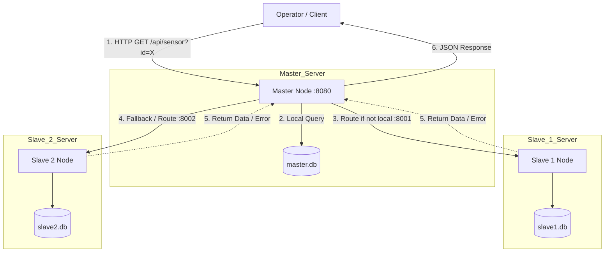


## 2.1 مدیریت پیکربندی شبکه و پایگاه‌داده
تمام مشخصات اجرایی بخش‌های `01` تا `05` در یک فایل مشترک در ریشه پروژه، یعنی `../config.txt`، نگهداری می‌شوند. Master آدرس مقصد Slaveها را در زمان اجرا از ترکیب `SLAVE*_IP` و `SLAVE*_PORT` می‌سازد و اسکریپت راه‌اندازی نیز همان مقادیر را برای Listener هر نود استفاده می‌کند. مسیرهای نسبی دیتابیس در هر بخش نسبت به پوشه همان نود تفسیر می‌شوند؛ بنابراین یک فایل مشترک می‌تواند برای همه بخش‌ها استفاده شود، در حالی که دیتابیس‌های هر بخش مستقل باقی می‌مانند. فایل ریشه‌ای `config.example` قالب تنظیمات را مستند می‌کند.


---

## 3. مسیر درخواست و پاسخ (معماری Asynchronous)
در این سیستم، مسیر درخواست بر اساس معماری **Event-Driven** و غیرهمزمان (Asynchronous) طراحی شده است تا از مسدود شدن سرور (Blocking) جلوگیری شود:
1. اپراتور درخواست را به Master ارسال می‌کند.
2. گره Master ابتدا دیتابیس محلی خود را بررسی می‌کند.
3. در صورت عدم یافتن داده، درخواست از طریق تابع `mg_http_connect` بدون توقف پردازنده به سمت Slave 1 فرستاده و Route می‌شود.
4. اگر Slave 1 پاسخ منفی دهد (یا در صورت قطعی شبکه، خطای `MG_EV_ERROR` رخ دهد)، مکانیزم **Fallback** فعال شده و درخواست بلافاصله به Slave 2 ارسال می‌گردد.
5. پس از آماده شدن پاسخ در Slave، رویداد `MG_EV_HTTP_MSG` در Master به عنوان Trigger عمل کرده و داده استخراج‌شده مستقیماً به اپراتور برگردانده می‌شود. 

این رویکرد علاوه بر جلوگیری از Starvation، تحمل خطای (Fault Tolerance) بالایی در برابر قطعی گره‌ها فراهم کرده است.

---

## 4. سناریوهای ارزیابی و تست شبکه
برای اطمینان از عملکرد صحیح سیستم، 4 سناریوی تست حیاتی روی شبکه اجرا شد:
### تست اول: Local Read (سنسور ۱۰۱)
در این تست، سنسور `101` درخواست شد. داده مستقیماً در دیتابیس Master قرار داشت و بدون درگیری اسلیوها پاسخ داده شد.

| خروجی Client | لاگ‌های Master | وضعیت Slaveها |
| :---: | :---: | :---: |
| 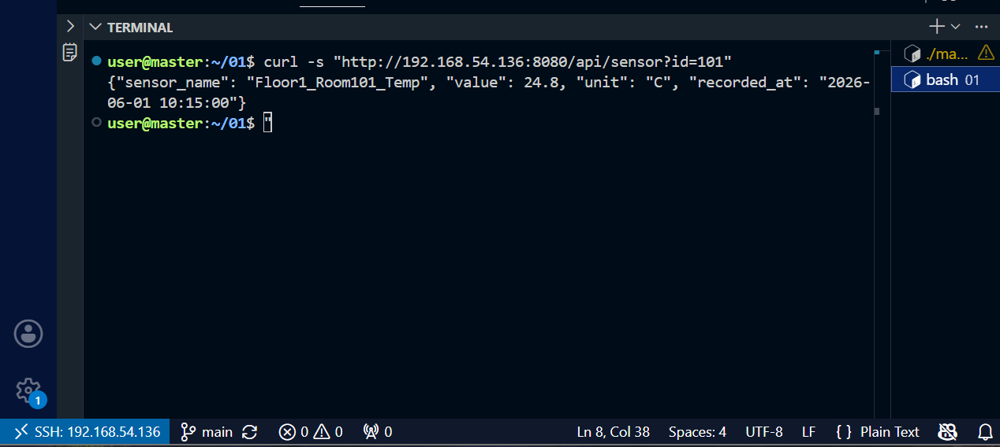 | 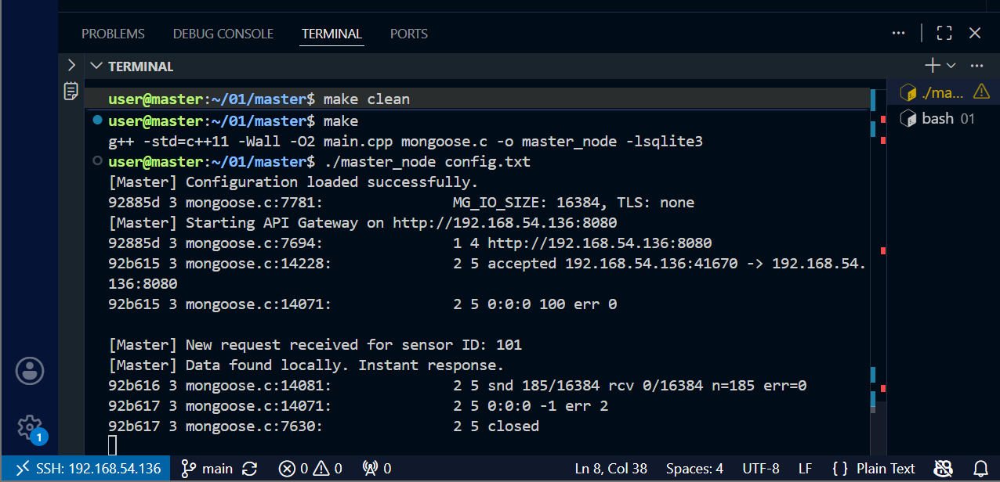 | 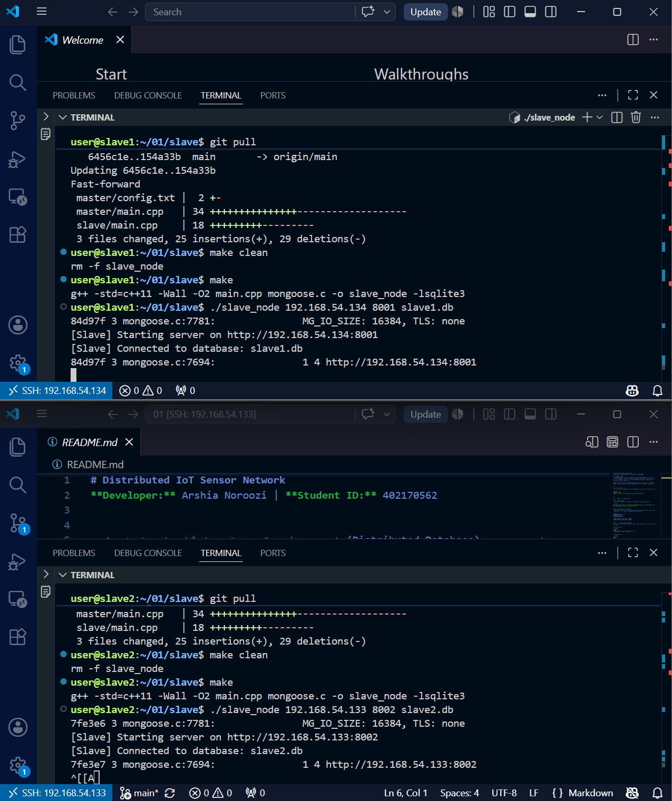 |

### تست دوم: Async Routing
سنسور `304` (موجود در Slave 2) درخواست شد. Master پس از عدم یافتن دیتا در خود، درخواست را به Slave 1 فرستاد. پس از دریافت پاسخ منفی، بدون توقف درخواست به Slave 2 ارسال و داده‌ها با موفقیت Forward گردید.

| خروجی Client | لاگ‌های Master | وضعیت Slaveها |
| :---: | :---: | :---: |
| 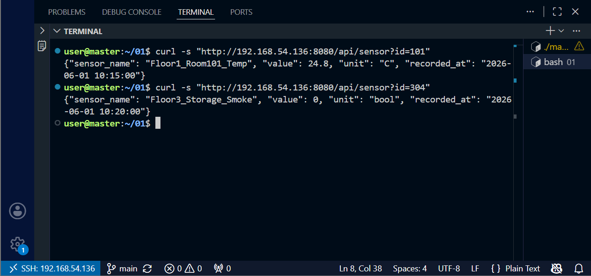 | 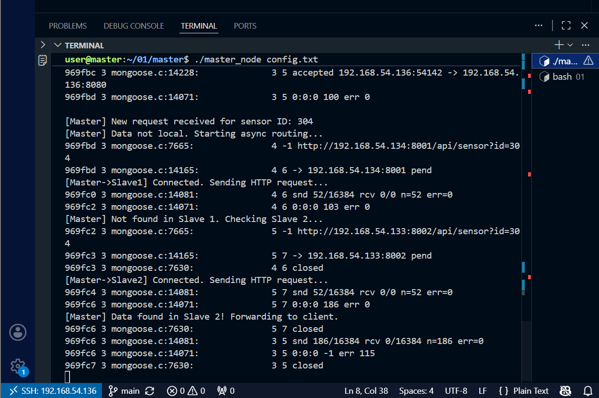 | 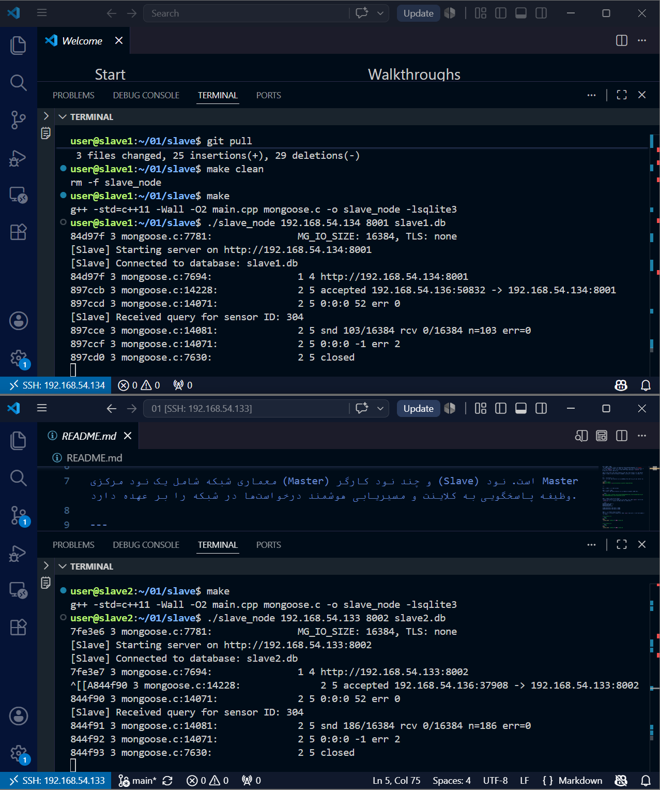 |

### تست سوم: 404 Not Found
سنسور `999` که در هیچ‌یک از گره‌ها وجود ندارد درخواست شد. سیستم پس از پیمایش کامل گره‌ها، به جای Crash، خطای استاندارد `404 Not Found` را بازگرداند.

| خروجی Client | لاگ‌های Master | وضعیت Slaveها |
| :---: | :---: | :---: |
| 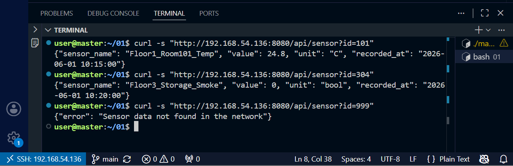 | 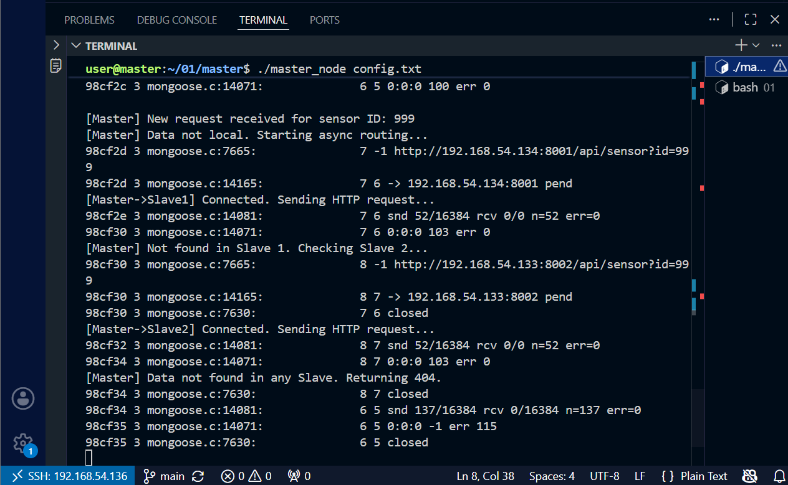 | 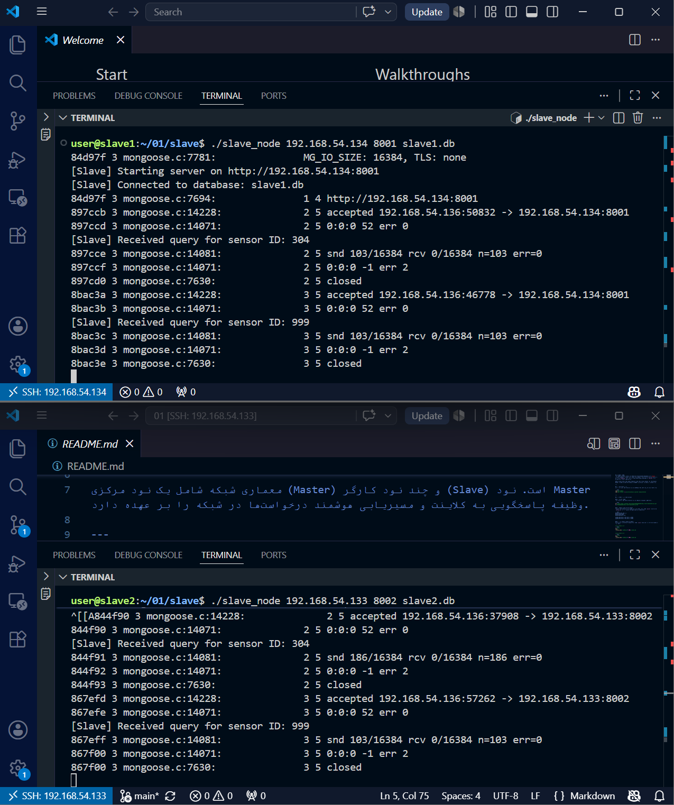 |


### تست چهارم: Fault Tolerance
ابتدا Slave 1 به صورت عمدی خاموش گردید و درخواست سنسور `304` ارسال شد. لاگ‌ها نشان می‌دهد Master با خطای `socket error` مواجه شده، اما به دلیل مکانیزم **Fallback**، سیستم مستقیماً درخواست را به Slave 2 ارسال کرده است.

| خروجی Client | لاگ‌های Master | وضعیت Slaveها |
| :---: | :---: | :---: |
| 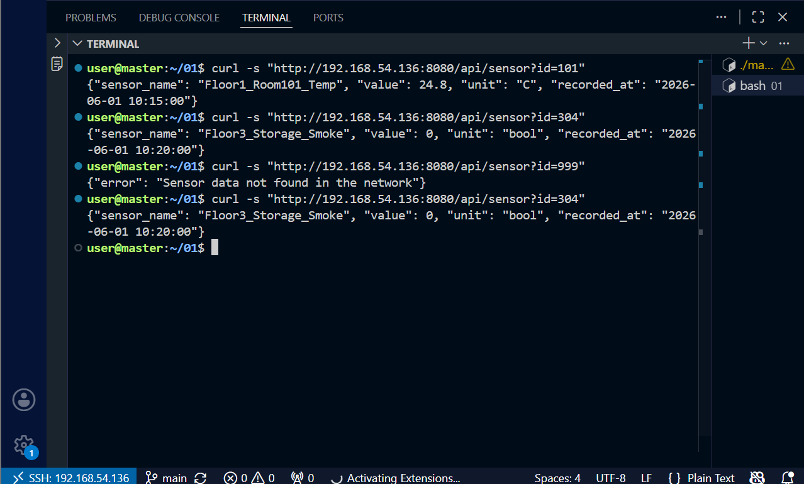 | 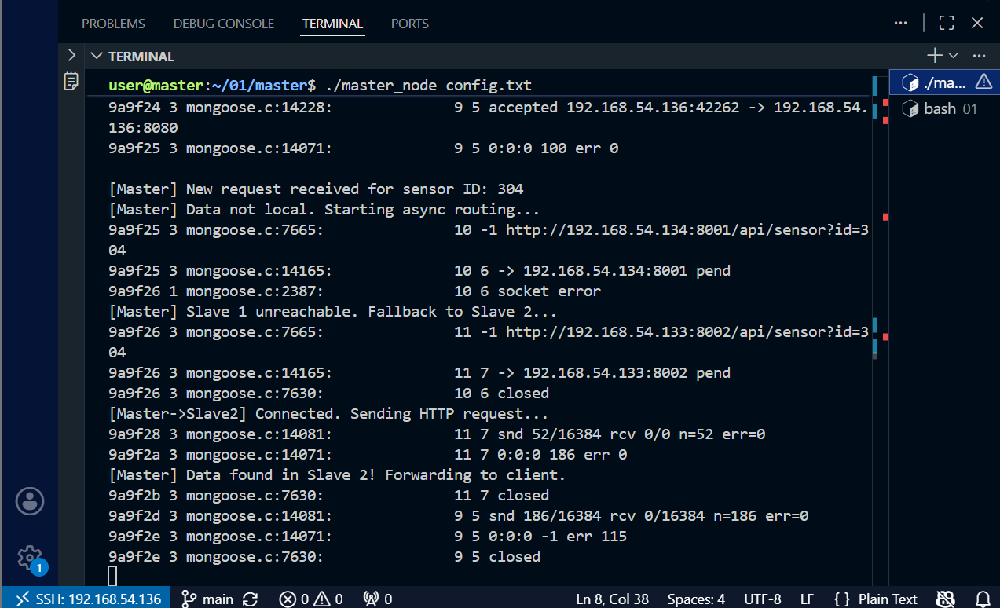 | 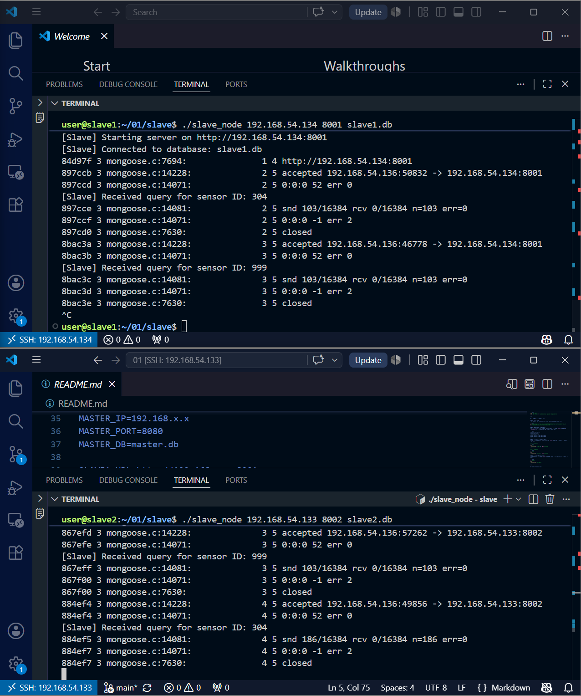 |

---


## 5. کنترل دسترسی و بررسی امنیت HTTP
برای اجرای قانون «اپراتور فقط با Master ارتباط دارد»، یک کلید مشترک با نام `MASTER_SLAVE_TOKEN` در فایل پیکربندی ریشه تعریف شده است. Master این مقدار را فقط در درخواست‌های داخلی، داخل هدر `X-Master-Token`، برای Slave ارسال می‌کند. Slave قبل از پردازش URI و دسترسی به SQLite، هدر را با مقدار پیکربندی‌شده مقایسه می‌کند. درخواست مستقیم اپراتور که این هدر معتبر را ندارد با وضعیت `403 Forbidden` رد می‌شود. اسکریپت تست نیز این سناریو را بررسی می‌کند.

این کنترل، دسترسی مستقیم تصادفی یا بدون مجوز را در لایه برنامه مسدود می‌کند، اما جایگزین رمزنگاری نیست؛ زیرا HTTP خام هدر و داده را به صورت Plain Text منتقل می‌کند. برای استقرار واقعی باید علاوه بر توکن، از HTTPS/TLS استفاده شود و Firewall نودهای Slave فقط اتصال از IP نود Master را مجاز کند. همچنین کلید نمونه باید با مقدار تصادفی طولانی تعویض و خارج از مخزن عمومی نگهداری شود.

</div>