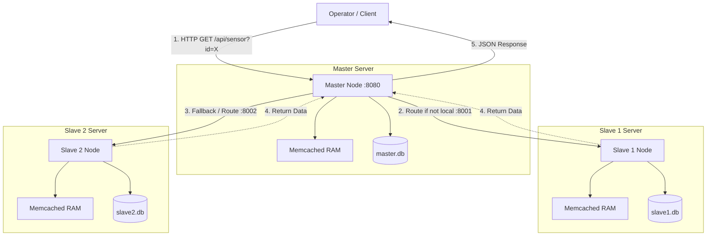
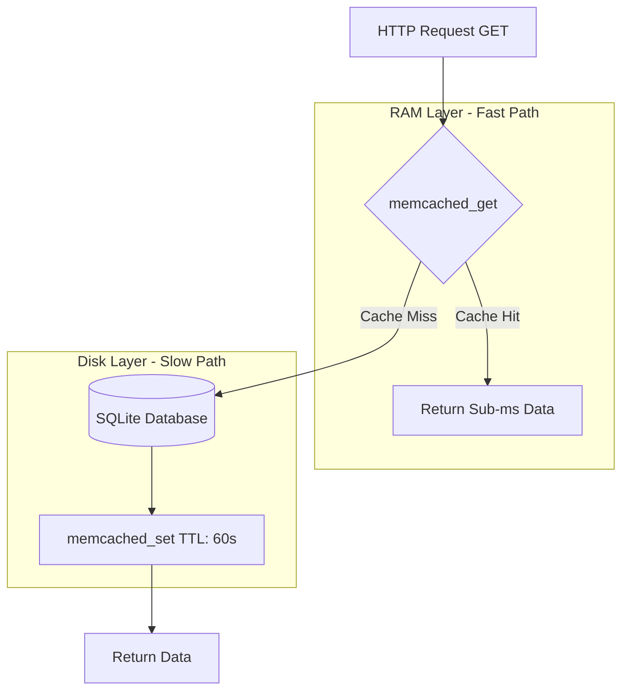
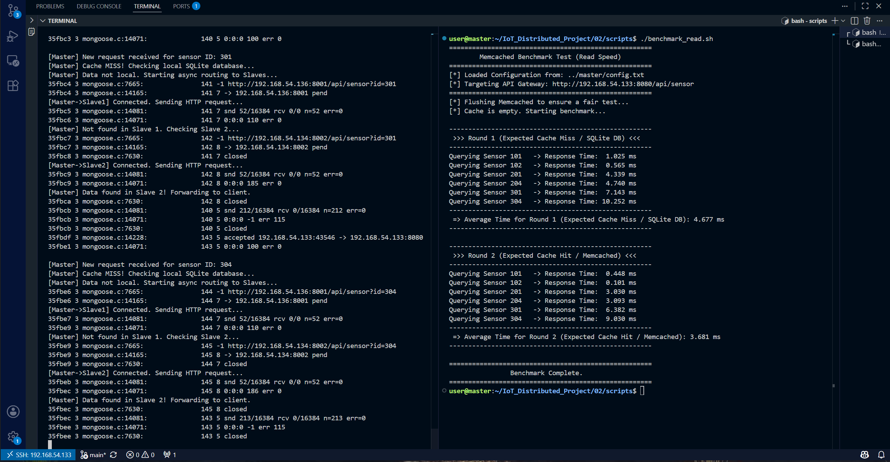
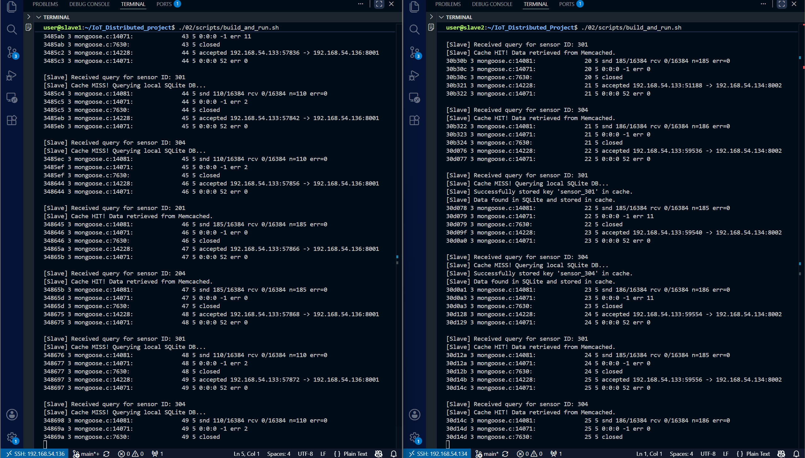

# گزارش معماری و طراحی سیستم پایگاه داده توزیع شده (بخش دوم)

**نام و نام خانوادگی:** عرشیا نوروزی (Arshiya Noroozi)  
**شماره دانشجویی:** 402170562  
**محیط توسعه:** C++, Mongoose, SQLite, Linux VMs  

---
## ۱. مقدمه و معماری سیستم
در این بخش از پروژه، به منظور کاهش بار پردازشی روی پایگاه داده اصلی (SQLite) و افزایش سرعت پاسخ دهی کلاستر، یک لایه کشینگ توزیع شده با استفاده از **Memcached** پیاده سازی شد. 
در این معماری، هر نود (چه Master و چه Slaveها) به صورت کاملا مستقل و ماژولار، دارای یک دیتابیس SQLite اختصاصی و یک سرویس Memcached لوکال در حافظه RAM خود می باشد.

> **نکته:** برای مشاهده نحوه کامپایل، نصب پیش نیازها و اجرای هوشمند سیستم (Auto-Detect)، لطفا به **بخش های 1 تا 4 در فایل `README.md`** مراجعه فرمایید.

---

## ۲. منطق و جریان داده در لایه کش (Caching Logic)
ساختار خواندن داده ها، تعامل نودهای کلاستر و لایه های ذخیره سازی به شرح زیر پیاده سازی شده است:

### ۱. معماری کلی سیستم و تعامل نودها
در این کلاستر، تمامی نودها به صورت یکپارچه مجهز به لایه کشینگ لوکال (Memcached) و دیتابیس دیسکی (SQLite) هستند:

### ۲. جریان منطقی داخلی لایه کش (Hit / Miss Pipeline)
فرآیند استخراج داده و چرخه انقضا در لایه کش هر نود (اعم از Master یا Slave) مطابق نمودار زیر صورت می گیرد:

### الف) زمان خواندن داده از کش (Cache Read)
به محض ورود یک درخواست (HTTP GET) به نود، سیستم ابتدا یک کلید یکتا (مثلا `sensor_101`) تولید کرده و با استفاده از تابع `memcached_get` حافظه کش لوکال خود را بررسی می کند. اگر داده در رم موجود باشد (Cache Hit)، بدون هیچ گونه درگیری با دیسک یا شبکه، داده بلافاصله استخراج شده و به کلاینت بازگردانده می شود.

### ب) زمان خواندن داده از SQLite (Cache Miss)
اگر خروجی تابع جستجو در کش خالی باشد، سیستم متوجه می شود که داده هنوز در کش قرار نگرفته است و یا منقضی شده است. در این حالت، کوئری مستقیما روی دیتابیس (SQLite) اجرا می شود.

### ج) نحوه مقداردهی کش (Cache Population)
پس از اینکه داده در زمان Cache Miss با موفقیت از SQLite خوانده شد، سیستم پیش از ارسال پاسخ به کلاینت، داده خام (فرمت JSON) را با استفاده از تابع `memcached_set` در لایه کش ذخیره می کند. 
در این پروژه زمان انقضا (TTL) برای کش برابر با **60 ثانیه** تنظیم شده است تا تعادلی منطقی بین تازگی داده (Data Freshness) و سرعت سیستم برقرار شود.

---
---
## ۳. تحلیل عملکرد شبکه و تست سرعت (Benchmark Analysis)
برای ارزیابی دقیق این معماری، یک اسکریپت خودکار (`benchmark_read.sh`) توسعه داده شد که درخواست ها را در دو دور (Round) متوالی ارسال و زمان پاسخ دهی (`response_time_ms`) را ثبت می کند.

> **راهنما:** برای مشاهده نحوه اجرای اسکریپت تست سرعت، به **بخش 6 در فایل `README.md`** مراجعه کنید.

### مستندات تصویری بنچمارک و لاگ ها

#### ۱. خروجی بنچمارک، سرعت پاسخ دهی و لاگ Gateway / Master
تصویر زیر خروجی دقیق اسکریپت بنچمارک (میانگین زمان پاسخ دهی کل کلاستر و سرعت هر داده) و لاگ نود Master را نمایش می دهد:

  

#### تحلیل نتایج دور اول (Round 1 - Cache Miss)
در دور اول، حافظه کش تمام نودها پیش از شروع تست به صورت دستی پاک (Flush) می شود. همان طور که در تصاویر فوق و نتایج بنچمارک مشاهده می شود، سیستم رفتار زیر را نشان می دهد:
*   **سنسورهای محلی Master (مثل 101 و 102):** درخواست ها با مواجهه با Cache Miss مستقیما به دیتابیس SQLite می روند. زمان پاسخ دهی در این حالت به دلیل سرعت بالای دسترسی محلی اما درگیری با دیسک، معمولا در بازه `0.5` تا `1` میلی ثانیه ثبت می شود.
*   **سنسورهای نودهای Slave (مثل 201 تا 304):** نود Master این درخواست ها را به دلیل عدم وجود در دیتابیس محلی، در بستر شبکه مسیردهی (Async Routing) می کند. نود Slave پس از دریافت، دیسک خود را می خواند و پاسخ را برمی گرداند. این فرآیند مجموعا به دلیل سربار شبکه و خواندن از دیسک اسلیو، بین `4` تا `11` میلی ثانیه زمان می برد.

#### تحلیل نتایج دور دوم (Round 2 - Cache Hit)
در دور دوم، تمامی داده ها در کش اختصاصی هر نود قرار گرفته اند. طبق خروجی عددی اسکریپت بنچمارک، میانگین زمان پاسخ دهی کل کلاستر از **`4.677 ms`** در دور اول به **`3.681 ms`** در دور دوم کاهش یافته است و تمام سنسورها بهبود سرعت را تجربه کرده اند:
*   **سنسورهای محلی Master:** زمان پاسخ دهی با افت چشمگیر به زیر `0.5` میلی ثانیه (حتی تا `0.1` میلی ثانیه) می رسد که نشان دهنده خواندن آنی از حافظه RAM است.
*   **سنسورهای نودهای Slave (پاسخ به چالش معماری):** مطابق لاگ نودهای Slave، درخواست های تکراری با موفقیت پیام `Cache HIT!` داده ها را مستقیما از Memcached لوکال برمی گردانند. در طراحی غیرمتمرکز این سیستم، نود Master از ذخیره سازی داده های مربوط به Slaveها در کش خود **جلوگیری می کند** تا از افزونگی داده (Data Duplication) جلوگیری شود. بنابراین، در دور دوم، مستر باز هم مجبور است درخواست را در بستر شبکه به Slave ارسال کند.
*   **مشاهده کلیدی:** با وجود تکرار مسیردهی شبکه در دور دوم، زمان ثبت شده برای **تمامی سنسورهای Slave به طور قطعی و بدون استثنا کمتر از دور اول است** (مثلا `3` تا `9` میلی ثانیه). این اعداد نشان دهنده **تاخیر خالص رفت وبرگشت شبکه (Network Jitter/Latency)** هستند و سربار I/O دیسک به طور کامل از چرخه حذف شده است.

#### ۲. عملکرد کش لوکال در نودهای Slave
تصویر زیر خروجی لاگ نودهای Slave را در زمان اجرای بنچمارک نمایش می دهد:

  

---
به طور خلاصه، این نتایج ثابت می کند که لایه Memcached توانسته گلوگاه سرعت دیتابیس را در تمام نودها برطرف کند و سیستم به یک تعادل استاندارد بین طراحی میکروسرویس و پرفورمنس رسیده است.

