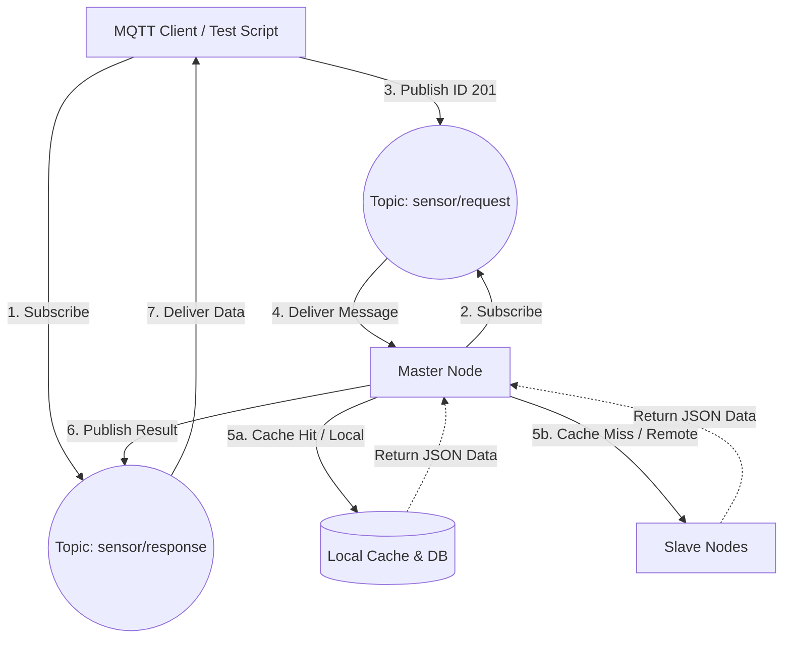
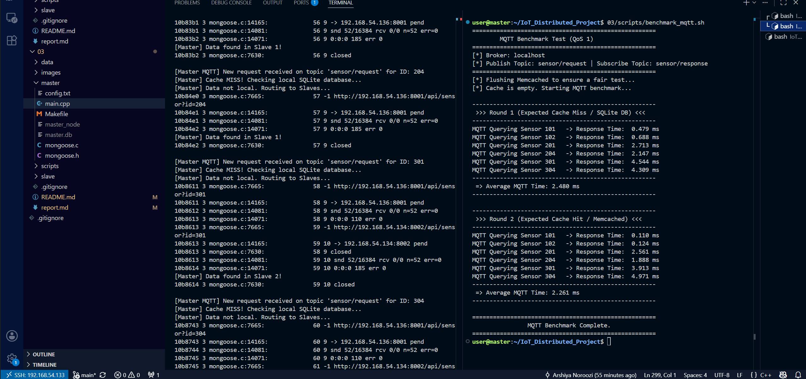
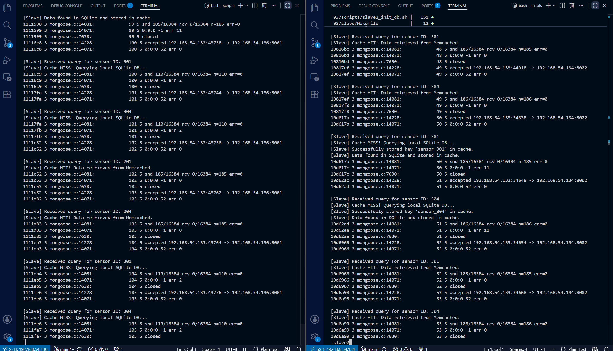

# گزارش بخش ۳: اتصال سیستم به پروتکل MQTT

## ۱. مقدمه و مشخصات پروتکل
در این بخش، سیستم ما از یک ارتباط ساده‌ی مبتنی بر HTTP به یک معماری اینترنت اشیا (IoT) ارتقا یافت. برای این منظور از پروتکل **MQTT نسخه 3.1.1** استفاده شده است، زیرا این نسخه بسیار پایدار بوده و پیاده‌سازی آن در محیط‌های لینوکسی سرراست است. 
نرم‌افزار استفاده شده به عنوان Broker (واسطه پیام‌ها) **Mosquitto** است که روی ماشین Master نصب و راه‌اندازی شده است.

### سطح کیفیت خدمات (QoS)
در تمام ارتباطات این پروژه (چه در سمت Publish و چه Subscribe) از **QoS 1 (At least once)** استفاده شده است.

**دلیل انتخاب:** در شبکه‌های سنسوری، اطمینان از رسیدن داده‌ها اهمیت دارد. سطح QoS 0 تضمینی برای رسیدن پیام ندارد و سطح QoS 2 سربار (Overhead) شبکه‌ای زیادی تولید می‌کند. سطح QoS 1 با استفاده از مکانیزم تاییدیه (ACK)، بهترین تعادل را بین سرعت ارتباط و اطمینان از رسیدن پیام فراهم می‌کند.

## ۲. طراحی تاپیک‌ها و معماری ارتباطی
نود Master در این فاز نقش یک پُل ارتباطی (Gateway) را ایفا می‌کند. ساختار تاپیک‌ها به شکل زیر طراحی شده است:

*   **تاپیک `sensor/request`:** 

کلاینت‌ها (اسکریپت تست) آیدی سنسور مورد نظر خود (مانند `101` یا `201`) را در این تاپیک Publish می‌کنند. مستر به طور دائم به این تاپیک گوش می‌دهد.

*   **تاپیک `sensor/response`:**

 مستر پس از دریافت درخواست، داده را از کش، دیتابیس لوکال یا گره‌های Slave استخراج کرده و نتیجه نهایی (JSON) را در این تاپیک Publish می‌کند تا کلاینتِ منتظر، آن را دریافت کند.

### دیاگرام جریان داده‌ها در شبکه MQTT

## ۳. نتایج تصویری و تحلیل تست سرعت اسکریپت benchmark_mqtt
برای بررسی عملکرد سیستم، اسکریپت `benchmark_mqtt.sh` اجرا شد که سنسورها را در دو دور فراخوانی می‌کند. برای تحلیل دقیق زمان‌های پاسخ‌دهی و اثبات عملکرد کش، خروجی بنچمارک و لاگ نودها در ادامه ضمیمه شده است:

### الف) خروجی بنچمارک و لاگ Gateway (نود Master)
تصویر زیر نمایانگر اجرای اسکریپت تست سرعت و لاگ‌های ثبت‌شده در نود Master است:

  

### ب) عملکرد کش لوکال در نودهای Slave
تصویر زیر لاگ‌های همزمانِ نودهای Slave 1 و Slave 2 را نمایش می‌دهد:

  

---

## ۴. تحلیل Network Jitter و تغییر bottleneck
با بررسی تصاویر فوق و مقایسه زمان‌ها در دور اول (Cache Miss) و دور دوم (Cache Hit)، رفتار سیستم با MQTT به صورت زیر است:

1. **عملکرد بی‌نقص کشینگ محلی:** 

در سنسورهای مربوط به خود مستر (مثل 101 و 102)، زمان پاسخ‌دهی در دور اول حدود `0.47ms` تا `0.68ms` بوده است که در دور دوم با موفقیت به حدود `0.11ms` افت کرده است. این کاهش چشمگیر نشان‌دهنده‌ی حذف کامل overhead sqlite3 است.

2. **تأیید عملکرد کش توزیع‌شده:** 

لاگ‌های نودهای Slave (در تصویر دوم) به وضوح نشان می‌دهند که در دور دوم، هر دو اسلیو پیام 

`[Slave] Cache HIT! Data retrieved from Memcached` 

را چاپ کرده‌اند. این یعنی اسلیوها بدون مراجعه به SQLite، داده را مستقیماً از حافظه RAM خوانده‌اند.

3. **تغییر bottleneck از sqlite به شبکه:**

با وجود اینکه اسلیوها داده را با بالاترین سرعت از کش می‌خوانند، در خروجی بنچمارک (تصویر اول) مشاهده می‌کنیم که زمان برخی سنسورهای ریموت در دور دوم کاهش نیافته و حتی اندکی افزایش یافته است (مثلاً سنسور 304 از `4.309ms` به `4.971ms` رسیده است). این رفتار ناشی از دلایل زیر است:

*   **کاهش سرعت بخاطر Context Switching:**

 نود Master به طور همزمان رویدادهای Mongoose و Mosquitto را پردازش می‌کند که تأخیرهای تصادفی در سطح سیستم‌عامل ایجاد می‌کند.

*   **پنهان شدن زمانِ دیسک در نوسان شبکه:**

 زمان صرفه‌جویی شده بابت نخواندن از دیسکِ اسلیو بسیار ناچیز است (کسری از میلی‌ثانیه). اما از طرف دیگر، بستر ارتباطی با سربارِ تاییدیه‌های **QoS 1** در MQTT و نوسانات طبیعی بین ماشین‌های مجازی (Network Jitter) درگیر است.

**نتیجه‌گیری:** نوسانات شبکه و سربار پروتکل MQTT، آن مقدار ناچیزِ زمانِ صرفه‌جویی‌شده از دیسک را در خود پنهان (Mask) می‌کنند. این مشاهدات به نشان میدهد که با اضافه‌شدن mqtt، **باتلنک سیستم از سخت‌افزار (سرعت دیسک) با موفقیت به بستر ارتباطی (تأخیر شبکه) منتقل شده است.**

