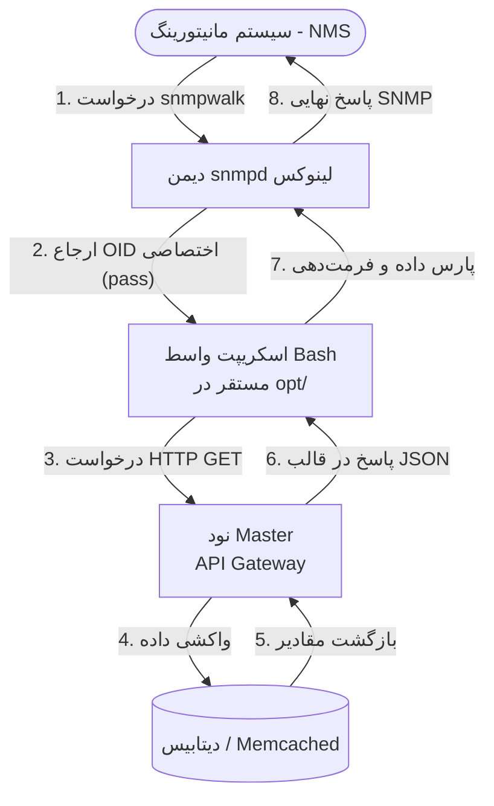

# گزارش طراحی بخش ۴: مانیتورینگ سیستم با پروتکل SNMP
**نام و نام خانوادگی:** عرشیا نوروزی (Arshia Noroozi)
**شماره دانشجویی:** 402170562

## 1. معماری کلی سیستم و اجزای اصلی
در سیستم‌های توزیع‌شده IoT، استفاده از پروتکل SNMP به ما اجازه می‌دهد وضعیت تمام نودها و سنسورها را توسط یک سیستم مانیتورینگ متمرکز (NMS) رصد کنیم. معماری این بخش شامل اجزای زیر است:
* **سیستم مانیتورینگ (NMS):** کلاینتی که درخواست‌های خواندن اطلاعات (مانند `snmpwalk`) را صادر می‌کند.
* **دیمن snmpd:** سرویس اصلی SNMP لینوکس که به صورت پیش‌فرض منابع سیستم را می‌خواند اما برای پروژه ما سفارشی‌سازی شده است.
* **فایل واسط (Bash Script):** اسکریپتی که درخواست‌های SNMP را به درخواست‌های HTTP تبدیل می‌کند.
* **نود Master (API Gateway):** نقطه‌ای که مقادیر نهایی سنسورها را از پایگاه داده یا سیستم کش (Memcached) می‌خواند.

## 2. ارتباط بین اجزا و مسیر درخواست و پاسخ
برای برقراری ارتباط بین پروتکل استاندارد SNMP و سیستم سفارشی ما، از دایرکتیو `pass` در پیکربندی `/etc/snmp/snmpd.conf` استفاده شده است. مسیر جریان داده به این شرح است:
1. کاربر یا سیستم مانیتورینگ درخواست SNMP را ارسال می‌کند.
2. دیمن `snmpd` با مشاهده OID اختصاصی، اسکریپت Bash ما را فراخوانی می‌کند.
3. اسکریپت به جای اتصال مستقیم به دیتابیس، یک درخواست HTTP GET به نود Master ارسال می‌کند (حفظ کپسوله‌سازی شبکه).
4. نود Master درخواست را پردازش کرده و داده‌ها را در قالب JSON برمی‌گرداند.
5. اسکریپت واسط خروجی JSON را با ابزارهای بومی لینوکس پارس کرده و به فرمت رشته‌ای استانداردِ SNMP به `snmpd` تحویل می‌دهد تا به کاربر نمایش داده شود.

## 3. دیاگرام جریان داده
فلوچارت زیر مسیر خطی و یکپارچه درخواست مانیتورینگ از سیستم NMS تا پایگاه داده را نشان می‌دهد:

## 4. ساختار ذخیره‌سازی و مفاهیم OID/MIB
شناسه OID (Object Identifier) آدرسی درختی و عددی است که مکان دقیق هر متغیر را مشخص می‌کند. برای رعایت استانداردها، از شماره دانشجویی به عنوان Enterprise ID اختصاصی استفاده شد:
* **شناسه پایه (Base OID):** `.1.3.6.1.4.1.402170562`
* **شناسه سنسورها:** مقادیر بعدی به ازای هر سنسور تعریف می‌شوند (مثلاً `.101` برای سنسور دما).
* **صفات (Attributes):** مقادیر `.1` برای نام، `.2` برای واحد و `.3` برای آخرین مقدار سنسور استفاده می‌شود.

## 5. تحلیل امنیتی (رفع چالش دسترسی)
دیمن `snmpd` در لینوکس با یک کاربر بسیار محدود اجرا می‌شود و سیستم‌های امنیتی (نظیر AppArmor) اجازه اجرای اسکریپت از مسیرهای شخصی کاربران (مانند `/home/`) را نمی‌دهند. برای حل اصولی این چالش، اسکریپت راه‌انداز سیستم به صورت خودکار فایل واسط را به مسیر استاندارد و امنِ نرم‌افزارهای جانبی یعنی `/opt/iot_project/` منتقل می‌کند تا سیستم بدون دور زدن مکانیزم‌های امنیتی لینوکس به درستی کار کند.

## 6. نحوه مدیریت تنظیمات IP و Port
پیکربندی شبکه به صورت کاملاً پویا (Dynamic) انجام شده است. اسکریپت نصاب پروژه در هنگام اجرا، آی‌پی Master را خوانده و آن را در داخل فایل واسط Bash (در مسیر `/opt/`) تزریق می‌کند. با این معماری، در صورت تغییر آدرس سرور Master، نیازی به دستکاری دستی کدهای SNMP نخواهد بود.

## 7. نحوه مدیریت خطاها
* **قطعی سرور Master:** در صورتی که نود Master در دسترس نباشد، اسکریپت Bash طوری طراحی شده است که در مواجهه با خطای Curl یا دریافت خروجی خالی، تایم‌اوت شده و `snmpd` نیز پیام استاندارد پایان درخت یا عدم وجود مقدار را صادر می‌کند تا از کرش کردن کل سرویس SNMP جلوگیری شود.
* **خطای OID نامعتبر:** اگر درخواستی برای سنسوری ناموجود ارسال شود، API نود Master خطای 404 برمی‌گرداند و اسکریپت واسط آن را به عنوان یک شناسه خالی (Null) به سمت `snmpd` مدیریت می‌کند.

## 8. تحلیل عملکرد و زمان پاسخ‌دهی
پروتکل SNMP ذاتاً به تاخیر حساس است و در صورت طولانی شدن پردازش، دچار تایم‌اوت (Timeout) می‌شود. در این معماری، از آنجایی که نود Master آخرین وضعیت سنسورها را از طریق سیستم کشینگ (Memcached) فراخوانی می‌کند، زمان پاسخ‌دهی به درخواست‌های HTTP به شدت کاهش یافته (در مقیاس چند میلی‌ثانیه) و اسکریپت Bash می‌تواند در سریع‌ترین زمان ممکن پاسخ SNMP را برای مانیتورینگ‌های دوره‌ای (Polling) آماده کند.