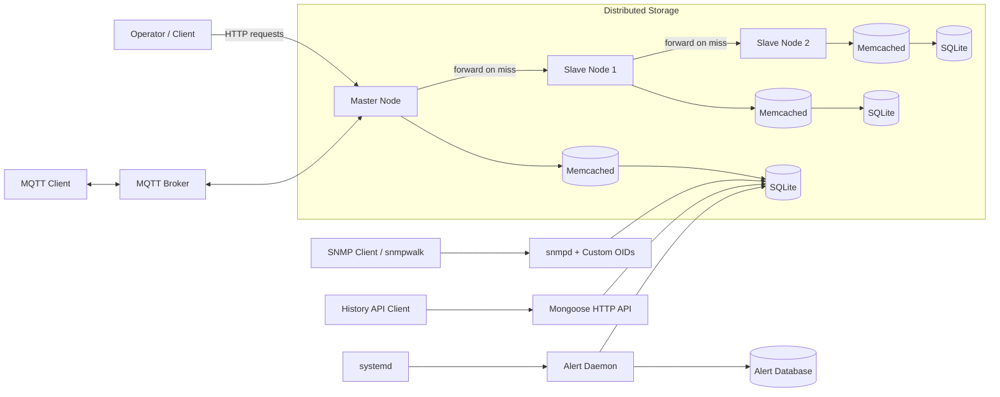

# Distributed IoT Monitoring System

A distributed sensor-data and monitoring system implemented in **C/C++** as part of an Embedded Systems course.

The project models an IoT deployment in which sensor data is distributed across multiple networked nodes. A central **Master** node handles client requests and coordinates lookups across **Slave** nodes, with later development stages introducing caching, MQTT messaging, SNMP monitoring, historical-data APIs, and automated alerting.

The coursework was implemented incrementally across **six independently runnable stages**, with each stage extending the functionality developed in the previous one.

> This repository originated as academic coursework. The original submitted version is preserved in the `coursework-submission` Git tag.

---

## System Overview

The base system consists of three networked nodes:

- one **Master** node
- two **Slave** nodes
- a local **SQLite** database on each node

Clients communicate only with the Master.

When a sensor is requested, the Master first checks its own local data. If the sensor is not available locally, the request is forwarded through the Slave nodes until the data is found or all nodes have been checked.

Later stages extend this architecture with:

- **Memcached** for cache-first sensor lookups
- **MQTT** for message-based sensor requests and responses
- **SNMP** with custom OIDs for sensor monitoring
- an HTTP API for querying historical sensor values
- a background alert daemon managed with `systemd`

---

## Architecture

The following diagram represents the overall system developed throughout the coursework.



The repository preserves each development stage separately rather than combining all source files into one final build. This reflects the incremental structure of the coursework and allows each stage to remain independently inspectable.

---

## Development Stages

### 01 — Distributed Database

[`01-distributed-database/`](01-distributed-database/)

Implements the base distributed sensor-data system.

The architecture consists of:

```text
Client
   |
   v
Master
   |
   | request forwarded if data is not local
   v
Slave 1
   |
   | request forwarded if data is still not found
   v
Slave 2
```

Each node maintains its own SQLite database containing sensor data.

The Master is the only node directly exposed to the client and is responsible for returning the final response.

**Concepts demonstrated**

- distributed request routing
- Master/Slave architecture
- SQLite
- HTTP communication
- Mongoose
- configurable network endpoints
- C/C++ networking

---

### 02 — Caching with Memcached

[`02-caching/`](02-caching/)

Extends the distributed database with an in-memory **Memcached** layer on each node.

Sensor reads follow a cache-first strategy:

```text
Request
   |
   v
Memcached
   |
   +---- cache hit ----> Response
   |
   +---- cache miss
             |
             v
           SQLite
             |
             v
       populate cache
             |
             v
          Response
```

The stage also includes benchmarking scripts for comparing uncached and cached sensor reads.

**Concepts demonstrated**

- cache-aside access pattern
- Memcached
- SQLite
- response-time measurement
- cache hit/miss behavior

---

### 03 — MQTT Messaging

[`03-mqtt/`](03-mqtt/)

Extends the previous system with **MQTT** communication.

An MQTT broker is introduced to provide message-based sensor requests and responses using defined MQTT topics.

The stage includes broker configuration and scripts for testing and benchmarking MQTT requests.

**Concepts demonstrated**

- MQTT
- publish/subscribe messaging
- MQTT topics
- broker configuration
- request/response messaging
- latency measurement

---

### 04 — SNMP Sensor Interface

[`04-snmp/`](04-snmp/)

Adds an **SNMP** interface for exposing sensor information.

Custom OIDs are used to make sensor information accessible through `snmpd`, allowing sensor values and metadata to be queried using standard SNMP tools such as `snmpwalk`.

**Concepts demonstrated**

- SNMP
- `snmpd`
- OIDs
- custom SNMP extensions
- sensor monitoring interfaces

---

### 05 — Sensor History API

[`05-sensor-history-api/`](05-sensor-history-api/)

Adds an HTTP API for retrieving historical sensor measurements for a specified sensor and date.

The API is implemented in C/C++ using **Mongoose** and reads historical data from SQLite.

Conceptually:

```text
HTTP Request
     |
     v
Mongoose API
     |
     v
SQLite
     |
     v
Historical sensor values
     |
     v
HTTP Response
```

**Concepts demonstrated**

- HTTP API design
- Mongoose
- SQLite queries
- structured request/response handling
- historical sensor-data retrieval

---

### 06 — Alert Daemon

[`06-alert-daemon/`](06-alert-daemon/)

Introduces a background daemon that periodically monitors sensor values and records alert events when configured conditions are met.

Alert information is persisted in a dedicated database and the daemon is designed to run as a Linux service through `systemd`.

**Concepts demonstrated**

- Linux daemons
- periodic monitoring
- configurable alert thresholds
- SQLite persistence
- `systemd` service management
- automated alert generation

---

## Repository Structure

```text
.
├── 01-distributed-database/
├── 02-caching/
├── 03-mqtt/
├── 04-snmp/
├── 05-sensor-history-api/
├── 06-alert-daemon/
├── config.txt
├── configuration.md
└── README.md
```

Each numbered directory represents a development milestone and contains its own source code, build files, scripts, documentation, test utilities, and supporting configuration.

---

## Technology Stack

### Languages

- C++
- C
- Bash

### Storage and Caching

- SQLite
- Memcached

### Networking and APIs

- HTTP
- Mongoose
- MQTT
- Mosquitto
- SNMP

### Linux

- Ubuntu Linux
- `systemd`
- shell scripting
- service configuration

### Build and Test

- Make
- Bash automation
- `curl`
- MQTT command-line tools
- SNMP command-line tools

---

## Design Highlights

### Distributed Lookup

Sensor data is distributed between nodes rather than requiring every node to contain every sensor.

A client sends its request to the Master, which either serves the request locally or forwards it through the configured Slave nodes.

### Cache-First Reads

Memcached provides an in-memory layer in front of SQLite.

Frequently requested sensor data can therefore be returned without performing the same database lookup repeatedly.

### Multiple Communication Interfaces

The project explores several communication and monitoring mechanisms:

- HTTP for client/API requests
- MQTT for publish/subscribe messaging
- SNMP for standardized monitoring access

This provides practical experience with different communication models within the same IoT scenario.

### Configuration-Driven Deployment

Network addresses, ports, database locations, and other runtime settings are intended to be supplied through configuration rather than embedded directly in application logic.

This allows the same programs to be deployed across different nodes without recompilation.

---

## Academic Context

This project was developed as **coursework for an Embedded Systems course**.

The assignment modeled a hotel sensor-monitoring environment in which sensor data is distributed across multiple nodes. The work was divided into six stages that progressively introduced distributed storage, caching, MQTT, SNMP, an HTTP history API, and automated alerting.

The project was designed primarily to explore:

- distributed-system fundamentals
- Linux-based service development
- database access from C/C++
- caching strategies
- HTTP APIs
- IoT messaging protocols
- system-monitoring protocols
- background services and alerting

It is an educational implementation rather than a production distributed database or production IoT platform.

The original coursework submission is preserved under the Git tag:

```text
coursework-submission
```

---

## Limitations

This project was designed for educational use and has a deliberately limited scope.

In particular:

- the distributed lookup architecture is not a replicated or consensus-based database system
- nodes use independently stored local sensor data
- later stages represent incremental coursework milestones rather than a single production deployment
- service configuration and deployment are designed primarily for a controlled local-network environment
- the system is not intended to provide production-grade high availability, fault tolerance, or security